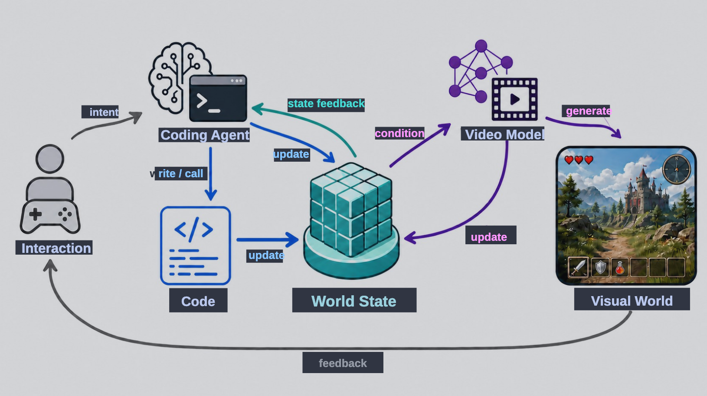

# 论文解析树：Code World Model

- 论文链接：https://arxiv.org/abs/2608.25927
- 官方代码 / 项目页：[Code](https://github.com/buaacyw/code-world-model) / [Website](https://buaacyw.github.io/cwm/)

### 1. Background

- **Task and application**: maintain persistent consequences and support coherent, open-ended evolution.
- **Previous methods and technical challenges**:
  - Challenge 1:视频记录了observable outcomes of dynamic world, 但是产生这些结果背后的规则无法被直接观察
    - Previous method: 直接从大规模视觉数据中学习dynamic world
    - Failure case / limitation: 无法维持persistent consequences，缺乏常识推理、长程规划与持续预测事件后果的能力，难以支撑开放式演化。
    - Technical reason: 视频只记录了可观测结果，且许多重要状态变化发生在视野外或者超出了模型的时间上下文
  - Challenge 2: World State Representation
    - Previous method: 使用结构化文本来表示世界状态，但是目前的视频模型无法可靠地遵循复杂指令；让 coding agent构建完整显式的 3D 世界并使用渲染结果最为条件，构建成本高且视觉上限被限制
- **Our pipeline / solution**:
  - Key innovation: 用 **coding agent 作为"世界大脑"通过可执行、可修改的代码维护持久世界状态并驱动规则一致的演化**，再通过一个**粗粒度 proxy** 把状态翻译成视频模型可直接解读的逐帧时空约束，让视频模型只负责高保真渲染。
  - 模块/贡献 1: Coding Agent 负责不频繁但是复杂的决策，将决策转化为可执行可复用可修改的代码，Code 负责高频确定性的更新
  - 模块/贡献 2: 引入 proxy作为对 world state的粗略表示，对 entity positions/poses/trajectories/spatial relations/camera motion 等进行编码，并使用轻量化编译器将其渲染为 proxy video，搭配结构化文本作为联合条件
- **Demos / applications**: 论文展示了哪些直观的 Demo 或应用案例？

### 2. Method

- **Overview**:
  - 任务: 构建接近现实世界因果复杂性的开放世界，同时保持高视觉保真度
  -  **overview pipeline:** 给定交互意图/动作 $A_t$，coding agent 读取当前世界状态，将意图翻译为对代码的调用或修改（写/改 code）；代码在世界状态 $S^{exe}_t$ 上执行高频确定性更新得到 $S^{exe}_{t+1}$；更新后的状态经确定性编译器渲染为 proxy video，与结构化文本 prompt 一起作为条件输入视频模型 $G_\theta$；视频模型结合上一视觉状态 $S^{vis}_t$ 生成高保真视觉观测 $S^{vis}_{t+1}$；生成的观测与状态反馈回流，支撑下一轮交互与世界演化。

形式化地，世界状态分解为可执行状态与视觉状态：

$$S_t = \left( S^{exe}_t, S^{vis}_t \right)$$

二者通过耦合的两条通路更新（$T_{AC}$ 为 agent–code 联合转移，$G_\theta$ 为视频模型）：

$$S^{exe}_{t+1} = T_{AC}\left( S^{exe}_t, A_t \right)$$

$$S^{vis}_{t+1} \sim G_\theta\left( S^{vis}_t, S^{exe}_{t+1} \right)$$

相比传统世界模型 $S_{t+1} \sim p(S_{t+1}|S_t, A_t)$、$O_{t+1} \sim p(O_{t+1}|S_{t+1})$，这里将演化与视觉渲染显式解耦。
- **Pipeline module 1: [Proxy]**
  - Motivation: 让视频模型能否 follow 精确高频率的实例位置/空间关系/相机轨迹的更新
  - 做法: 将影响当前观测的相机、实体位置、朝向、轨迹、空间关系组织为粗粒度可编程表示 proxy；coding agent 程序化地调用并组合一组简单可复用图元（每个图元仅需几行代码；可寻址参数指定实体位置、尺度、姿态、布局、相机与状态标记；常见类别如人、树、车辆、建筑由 agent 分类并组合相应图元，结构复杂/罕见物体退化为 bounding box 标注位置与范围，身份与属性交给文本）；一个简单的确定性编译器进行轻量光栅化，生成 proxy video（不表达纹理、材质、精细光照等外观信息）。proxy 与结构化文本源自同一世界状态，构成两条互补条件通道：文本传达语义意图，proxy 表达逐帧可调约束。
  - 为什么能 work: proxy 只保留了当前 observation 必须的粗糙结构和交互状态
  - Technical advantage: 相比纯文本：在空间控制上精确得多，且 proxy 每维分辨率仅为目标的 1/4，仅增加 $1/16$ 的视觉 token，额外推理开销可忽略；相比显式 3D：无需生产级资产、材质、光照、精细动画与昂贵渲染，可构建、可检查、可寻址、可局部编辑，视觉上限由视频模型先验决定，随数据/模型/算力扩展。
- **Pipeline module 2: [Proxy–目标对构建]**
  -  **Motivation :** 训练视频模型"读懂并遵循 proxy"需要时空对齐的 proxy–目标视频对；同时希望纳入真实视频以突破游戏管线的视觉/动态上限，但真实视频通常缺乏动作/相机标注。
  -  **Implementation :** 
    *   *游戏数据：* 同一次游戏执行中同步录制目标视频与运行时状态，只记录构建 proxy 所需变量（相机状态、实体位置朝向、近似尺度、场景布局、交互关键状态），不保留完整 3D 模型/纹理/材质；沿目标视频的相机轨迹渲染 proxy，形成同一过程的条件–目标对。同一录制可重编译为不同覆盖面/粒度的 proxy。运行时录制还提供逐帧逐像素的实例真值图（instance map），把结构化文本中每个身份的外观/属性/动作描述绑定到对应 proxy 区域。为保证 coding agent 推理时能轻松复现 proxy，刻意排除骨骼姿态、精细 3D 模型等难以构建维护的表示。
    *   *真实数据（KITTI-360 概念验证）：* 校正后的 RGB 帧作为目标观测；标定相机位姿、累积的语义 3D 重建与 3D 物体标注仅用于离线编译条件，不提供给视频模型。静态场景几何投影得到米制深度与法线；行人用胶囊骨架、车辆用线框、植被用低多边形代理、大型建筑用粗略 3D 范围表示；投影几何与 proxy 图元经共享深度缓冲光栅化，保留相机运动、空间对齐与遮挡。按帧索引建立 RGB 目标与编译条件的一一对应。
  -   **Why it works:** 动作后果与相机运动已直接编码在 proxy 中，因此该接口既不需要独立动作标签也不需要显式相机位姿标注，显著降低真实视频的标注负担；逐像素实例对应进一步把文本描述精确绑定到 proxy 区域。
  -   **Advantage:** 相比依赖独立动作/相机条件的接口（如 Matrix-Game、WorldPlay 等），将真实视频转化为训练数据不需要语义粒度模糊的动作标注或难以估计的连续相机标注；游戏运行时录制可"一次采集、多种 proxy 重编译"，无需重新采集目标视频。

### 3. Experiments

### 3.1 Comparison Experiments 
*   **Baselines:** 定性对比动作/相机条件或文本条件的视频世界模型（文中提及 LingBot-World 2.0、WorldPlay、Matrix-Game 3.0 等控制接口，仅通过文本或低维信号表达粗粒度意图）；对比在论文项目页面的视频中呈现，且为隔离控制质量不考虑推理延迟。
*   **Datasets:** 训练用 157 段 GTA V 游戏录制（约 5.6 小时源视频），以 2 秒间隔采样 9,420 个 5 秒训练片段；目标为 124 帧、$1344\times768$、24 FPS，对齐的 proxy 条件为 124 帧、$336\times192$（fixed-log 深度 + 类别语义 ID 图）。真实数据概念验证使用 KITTI-360。定性评估使用 coding agent 构建的简单交互世界录制的 proxy（5 组不同风格的 prompt：美少女战士法杖舞、007 泻湖战斗、水墨鳐鱼飞艇、蒲公英信使、黄铜钟朝圣者等）。
*   **Metrics:** 论文未提供定量指标；评估为定性（视觉质量、对 proxy 指定的实体位置/动作轨迹/场景布局/相机轨迹的遵循程度）。
*   **Core Conclusion:** 仅在约 5 小时 GTA V 配对数据上做 LoRA 微调后，MiniMax-H3 即可紧密遵循 proxy 指定的实体位置与运动、场景布局和相机轨迹，同时保留高保真外观与细粒度动态，并对训练分布外的多样角色、环境、运动和相机轨迹展现出较强泛化；定性对比显示 proxy 条件比动作/相机条件接口提供更精确、响应更快的逐帧时空控制。

实现细节：以官方 MiniMax-H3 Ref2V A 为骨干，全部 50 个 transformer block 施加 rank-128 LoRA（约 596M 可训练参数），8×H800、AdamW、全局 batch 8、3 epoch（3,534 步）、$2\times10^{-5}\to1\times10^{-6}$ 余弦学习率；推理用 GPT-5.6 Sol 作为 coding agent（基于现有游戏引擎代码与 proxy 图元搭建世界），GPT Image 2 依据首个 proxy 帧与文本生成首帧外观锚点；采样用 20 步显式 Euler；长视频用 124 帧窗口、34 帧重叠滑动拼接。

### 4. Limitation

*   **Failure Cases (失败场景):** 
    1. 受算力限制，训练规模小（仅约 5 小时 GTA V 数据、3 个 epoch 的 LoRA），生成质量仍有限；且未实现自回归实时生成，长视频依赖 34 帧重叠窗口滑窗拼接。
    2. 当前 coding agent 难以从零可靠实现高度复杂的游戏机制，原型未演示自主构建完整开放世界游戏/模拟器——实验中 agent 实际是以现有 AAA 游戏场景与玩法逻辑为模板进行组合、扩展和改写。
    3. 当 proxy 带宽不足或图元区分度不够时，复杂/罕见物体只能退化为 bounding box，细粒度交互约束变弱；关节级精细动作控制超出现有 agent 能力。
*   **Root Cause (原因分析):** 局限 1 源于视频模型本身的能力与训练数据/算力规模——proxy 只提供约束，外观与细粒度动态完全依赖视频模型先验；局限 2 源于 coding agent 的当前能力边界，框架把"世界机制的正确性"高度寄托于 agent 的编程可靠性，而 agent–code 循环中的错误（bug、错误机制）会直接持久化进世界状态并长期传播。