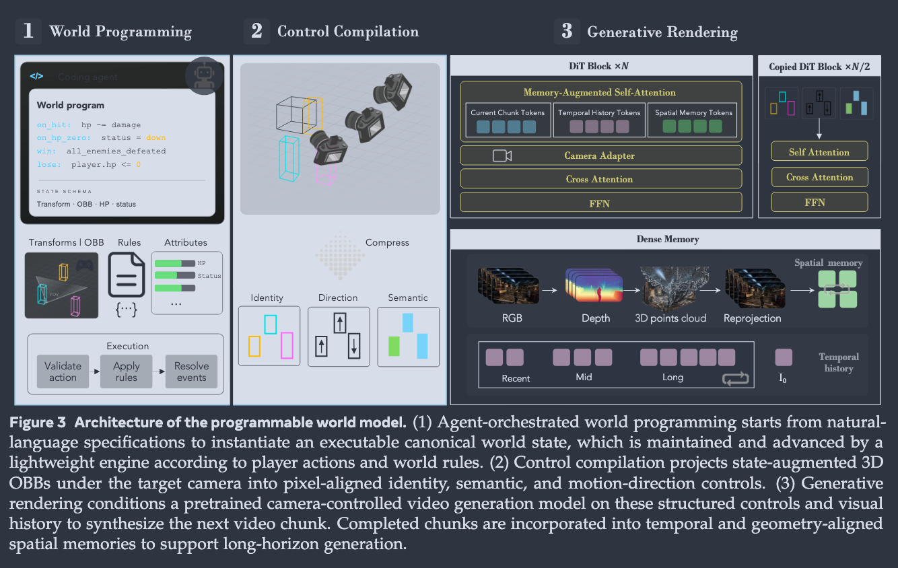

# Programmable World Model

- 论文链接：https://arxiv.org/abs/2609.10540
- 官方代码 / 项目页：[Code](https://github.com/AlayaLab/pwm) / [Website](https://alaya-lab.github.io/pwm/)

### 1. Background

- **Task and application**: iteractive world model
- **Previous methods and technical challenges（已有方法与挑战展开）**:
  - Challenge 1:缺少 Entity-Level Control
    - Previous method: 现有 world model 主要支持 Camera Control/Action Control/Prompt Control
    - Failure case / limitation: 控制方式不够精确，自然语言可以描述需求但是模型不一定准确执行
  - Challenge 2:缺少显式的世界状态表示
    - Previous method: 传统的视频模型能够根据历史画面维护一定的视觉记忆，但 Visual Memory 不等于 World State。
  - Challenge 3:用户无法控制世界演化的规则
- **Discussion of Representation Trade-offs**：
  - 
- **Contribution 1: Programmable World Model 框架（状态增强 3D OBB + 确定性状态编译器）**
  - *解决了什么问题:* 将世界状态的演变和生成渲染解耦
  - *宏观上怎么做:* Coding agent 把自然语言指令翻译为定义实体状态与交互规则的可执行程序；轻量引擎执行程序维护权威世界状态；状态编译器把状态增强 3D OBB 沿目标相机投影并栅格化为像素对齐的时空控制信号，驱动预训练视频模型渲染。
  - *核心优势:* 实体级直接控制、跨视角/遮挡的持久状态、用户可编程规则，同时训练–推理使用同一套可由程序构造的表示，缓解失配。
- **Contribution 2: 自动训练数据管线（Data Engine）**
  - *解决了什么问题:* 野外视频缺少相机几何、持久实例 ID、语义与物体运动等结构化标注。
  - *宏观上怎么做:* 用 ViPE 估计相机内参/位姿/度量深度，Qwen3-VL 发现语义类别，SAM3 做实例分割跟踪，WildDet3D 估计逐帧 3D OBB，再投影栅格化为条件图。
  - *核心优势:* 为可编程生成世界提供了可扩展的训练数据获取路径。
- **Contribution 3: CombatStateBench 基准**
  - *解决了什么问题:* 缺少评估生成视频与引擎维护世界状态一致性的受控基准。
  - *宏观上怎么做:* 50 个战斗场景 clip，包含多样的相机与实体运动，度量可见存活角色数（Count Accuracy）与死亡状态的视觉实现（State Accuracy）。
  - *核心优势:* 本文方法达到 94% Count Accuracy 和 98% State Accuracy，大幅超越现有交互式视频世界模型。

### 2. Method

### 2.1 Overview 
*   **overview pipeline:** 给定初始观测 $I_0$ 与自然语言描述，
    *   (1) 基于 VLM 的 coding agent 结合现成的 3D 检测器恢复可见实体的初始布局，生成指定实体初始状态、关系、动作与规则的可执行世界程序，轻量引擎据此实例化权威世界状态 $s_0$；
    *   (2) 交互时引擎根据玩家动作与规则执行状态转移 $s_{t+1} = F(s_t, a_t)$，状态编译器 $P$ 将更新后的状态增强 3D OBB 沿目标相机 $C_{t+1}$ 投影并栅格化为身份/语义/方向三张控制图 $M^{\mathrm{ctrl}}_{t+1}$；
    *   (3) 生成式渲染器（基于 LingBot-World-v1，附加可训练的 Structured Spatial ControlNet）在这些控制、相机条件与视觉历史（时间历史 + 几何对齐空间记忆）下合成下一个视频块，长程生成以 chunk 自回归方式推进。

### 2.2 Module 1: Agent-Orchestrated Box World
*   **Motivation :** 需要一个独立于当前视角、可被程序直接读写和验证的权威世界状态，使世界规则可编程、状态持久且不受生成模型隐式记忆漂移影响。
*   **Implementation :** 每个实体用 3D oriented bounding box（OBB）锚定其位置、尺寸与朝向，并附加持久身份、语义类别、动态状态与外观属性；权威世界状态写作
$$s_t = (\mathcal{E}_t, \mathcal{A}_t, \mathcal{Q}_t; \mathcal{R}_t)$$
其中:
      * $\mathcal{E}_t$ 为持久实体及其 3D 位姿
      * $\mathcal{A}_t$ 为语义与功能属性
      * $\mathcal{Q}_t$ 为实体间关系（如敌对、归属）
      * $\mathcal{R}_t$ 为可执行世界规则。
      * 初始化时由现成 3D 检测器从 $I_0$ 恢复可见实体得到 $\mathcal{E}_0$，agent orchestrator 将恢复的 3D 布局与自然语言描述 $q$ 结合，生成引擎可读的世界程序（含初始属性、关系、动作、规则、事件触发与任务目标），并通过持久标识符绑定到检测出的实体。交互时引擎逐步评估动作合法性、施加效果、解析触发事件：$s_{t+1} = F(s_t, a_t)$；血量、物品、阵营等不可直接视觉化的"潜在世界事实"由引擎显式维护并影响后续转移。
*   **Why it works:** 状态演化由显式规则执行而非学习预测，杜绝了 StatePlay/MASS 式学习状态转移带来的误差累积；OBB 用紧凑固定的几何参数（无需网格、材质、骨骼或预定义动画）提供视角无关、可重投影的世界系支架。
*   **Advantage:** 相比文本/2D 控制，它定义了可跨视角确定性重投影的世界系结构；相比完整 3D 场景/G-buffer/关节模型，它把显式维护的自由度限制在紧凑的实体级空间，推理时无需系统自己求解精细几何与动态。

### 2.3 Module 2: Control Compilation
*   **Motivation :** 引擎输出的世界状态处于 3D 世界系且含非视觉变量，不是渲染器可直接消费的形式；需要确定性编译为与目标相机像素对齐的条件，同时解耦相机运动与物体自身运动。
*   **Implementation :** 编译器 $P$ 提取渲染相关状态变量并在目标相机下投影：$M^{\mathrm{ctrl}}_{t+1} = P(s_{t+1}, C_{t+1})$。具体构建三张空间对齐的控制图：
    *   **身份图 $M^{\mathrm{id}}$：** 维护 $K$ 个learnable identity embeddings的库 $E^{\mathrm{id}} = \{q^{\mathrm{id}}_j\}_{j=1}^K$，每个持久实体分配到固定的身份槽，将其嵌入栅格化到 OBB 的可见投影区域；训练中槽位在样本间随机分配、序列内固定，推理时对每个持久实体保持槽位不变，从而跨遮挡/出画-再入维持实例一致性。
    *   **语义图 $M^{\mathrm{sem}}$：** 由预训练文本编码器编码语义标签 $q^{\mathrm{sem}}_i = E^{\mathrm{text}}(y_i)$ 并栅格化到投影区域，背景置零；重叠盒用深度感知栅格化（z-buffer）保留可见实体。对初始帧中不存在或缺少外观参考的实体尤其有用。
    *   **方向图 $M^{\mathrm{dir}}$：** 取引擎维护的实体世界系速度，旋转到目标相机系并量化为七种状态（forward/backward/left/right/static/up/down），用 7 个可学习方向嵌入 $E^{\mathrm{dir}} = \{q^{\mathrm{dir}}_\ell\}_{\ell=1}^7$ 栅格化。由于方向来自世界系速度而非图像位移，相机运动导致的表观位移不会改变静止实体的 static 状态。
    *   三图沿通道拼接：$M^{\mathrm{ctrl}}_{t+1} = \mathrm{Concat}(M^{\mathrm{id}}_{t+1}, M^{\mathrm{sem}}_{t+1}, M^{\mathrm{dir}}_{t+1})$。
*   **Why it works:** 显式分离了"哪个实例 / 什么类别 / 朝哪运动"三类信息；世界系速度导出的方向状态消除了相机-物体运动歧义；确定性投影使控制信号与相机条件天然对齐，避免 RenderFormer 式直接 token-to-image 中投影关系需模型自行学习的问题。
*   **Advantage:** 相比纯文本或 2D 控制，提供了视角一致、像素对齐、可程序构造的密集时空引导；相比 G-buffer 级条件，标注与推理构造都更轻，把纹理、关节运动等留给生成先验。

### 2.4 Module 3: Generative Renderer
*   **Motivation :** 利用预训练视频模型的视觉/动态先验补全控制信号未指定的精细外观与动态，同时支持长程一致生成。
*   **Implementation :** 骨干为 LingBot-World-v1（含相机条件模块），附加可训练的 Structured Spatial ControlNet。控制序列 $M^{\mathrm{ctrl}}_{1:T}$ 在视频 latent 空间分辨率下编码，ControlNet 产生逐层控制特征并注入主干：$h^{(\ell)}_{\mathrm{main}} \leftarrow h^{(\ell)}_{\mathrm{main}} + r^{(\ell)}$。训练时冻结预训练主干（含相机路径）参数 $\theta$，只优化空间控制分支 $\phi$：$I_{1:T} = G_{\theta,\phi}(I_0, C, M^{\mathrm{ctrl}}_{1:T})$。长程生成采用 chunk 自回归：块内双向去噪、块间因果传播，第 $n$ 块（$n \geq 2$）额外条件于时间历史 $\mathcal{H}^{(n)}_{\mathrm{temp}}$ 与几何对齐空间记忆 $\mathcal{H}^{(n)}_{\mathrm{spa}}$：
$$I^{(n)} = G_{\theta,\phi,\psi}(C^{(n)}, M^{\mathrm{ctrl},(n)}, \mathcal{H}^{(n)}_{\mathrm{temp}}, \mathcal{H}^{(n)}_{\mathrm{spa}})$$
时间历史按近/中/远程多分辨率组织并保留初始观测 $I_0$ 的 latent 作为持久锚点，训练时对历史做加噪、特征损坏、部分丢弃的随机退化以增强鲁棒性；空间记忆沿用 AlayaWorld 的机制，将已完成 RGB 帧用估计深度与相机参数提升到世界系、按需重投影到目标视角作为空间 latent token，且只从已完成的历史块更新以保持因果性。
*   **Why it works:** 相机路径控制全局视角演化、空间控制分支约束实体的位置/身份/类别/自身运动，两者互补；多尺度时间记忆与世界系空间记忆分别覆盖局部近期上下文与长程重访一致性。
*   **Advantage:** 冻结主干保留强大生成先验，训练成本低；双记忆机制支持 897 帧级长程自回归生成而不明显漂移。

### 2.5 Module 4: Automatic Training Data Pipeline
*   **Motivation :** 训练需要相机几何、持久实例身份、语义与物体运动的结构化标注，野外视频通常没有这些标注。
*   **Implementation :** 
    *   (1) 用 ViPE 估计相机内参、位姿与逐帧度量深度；
    *   (2) 用 Qwen3-VL 生成全局 caption 并发现离散可数类别集合；
    *   (3) 用 SAM3 做视频实例分割与跟踪，得到时序关联的掩码、2D 框、语义标签与持久 track ID，丢弃可见面积过小的掩码；
    *   (4) 将 2D 框、RGB、深度与内参交给 WildDet3D 估计逐帧 3D OBB：$b_i^t = (p_i^t, d_i^t, R_i^t, \ell_i, k_i)$（中心、尺寸、朝向、语义标签、track ID），经相机位姿变换到共享世界系形成时序一致的物体轨迹；由相邻帧世界系中心位移估计物体运动（消除相机表观运动），旋转到相机系并量化为七种状态，设小位移阈值判 static；
    *   (5) 将 3D OBB 用相机参数投影回各帧，z-buffer 处理遮挡，生成身份/语义/方向三张条件图。
*   **Why it works:** 各组件（ViPE/SAM3/WildDet3D/Qwen3-VL）均为现成强模型，组合后自动产出与推理时同构的条件信号，保证训练–推理表示对齐。
*   **Advantage:** 无需人工 3D 标注即可扩展到野外视频，是训练可编程生成世界的可扩展数据来源。
### 3. Experiments

### 3.1 Comparison Experiments
*   **Baselines:** LingBot-World-V2 与 YUME 两个代表性交互式视频世界模型。由于两者均无外部实例级状态接口，公平起见使用相同初始观测与基准状态转移，通过 prompt switching（"{environment description}. {action description}."）传达状态转移，保留其原生条件通路。
*   **Datasets:** 自建 CombatStateBench（50 个战斗场景 clip，含多样相机/实体运动、画面外实体交互与死亡事件；由自动校验器检查重投影、深度一致性、几何、地面接触、时序连续性等一致性后保留）。训练数据为 Cyberpunk 2077（第一人称）、Forza Horizon 6、Grand Theft Auto V（第三人称多视角）的无 HUD 游戏视频，经 Data Engine 处理。
*   **Metrics:** 用 Qwen3.6-27B 作为 VLM 评判（仅看生成的 RGB 帧，不提供任何 GT 空间标注）。**Count Accuracy**（每视频随机抽 8 帧、共 400 帧，比较 VLM 数的可见存活角色数与引擎记录值 $\mathrm{CountAcc} = \frac{1}{N}\sum_{i=1}^N \mathbb{1}[\hat{n}_i = n^{\mathrm{eng}}_i]$）与 **State Accuracy**（每个死亡事件转移后均匀抽 3 帧，判断至少一帧呈现死亡角色，共 50 个事件）。视频质量用 VBench 四项：Imaging Quality、Subject Consistency、Background Consistency、Temporal Stability。
*   **Core Conclusion:** 本文在 Count Accuracy 上达 94.00%（LingBot-World-V2 40.75%、YUME 32.00%，分别领先 53.25/62.00 个百分点），State Accuracy 达 98.00%（基线 8.00%/58.00%，领先 90.00/40.00 个百分点），证明"引擎维护显式状态 + 结构化空间控制"远优于生成模型的隐式状态表示；同时四项 VBench 质量指标全部最优（67.62 / 94.74 / 96.98 / 99.00），说明结构化控制在提升一致性的同时不牺牲画质。定性结果还展示了新角色（牛头人场景）、大角度相机旋转后正确揭示初始视野外实体、赛车场景跨类型泛化、人车异构类别联合渲染以及 897 帧 NPC 陆续入场的长程生成。

---

## 4. Limitation & Future Work

todo